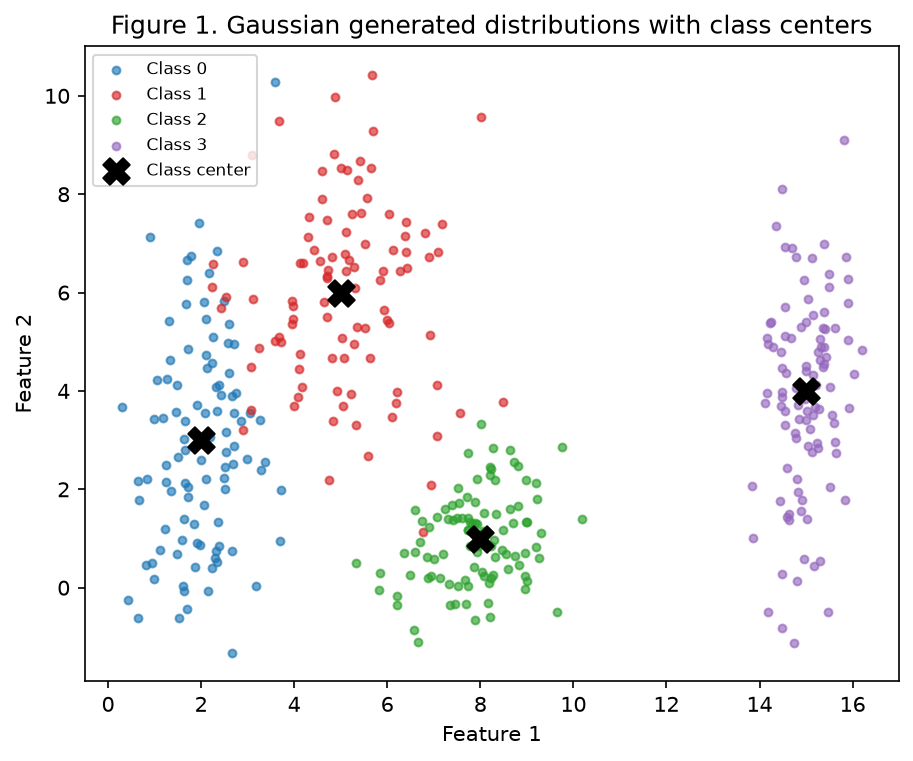
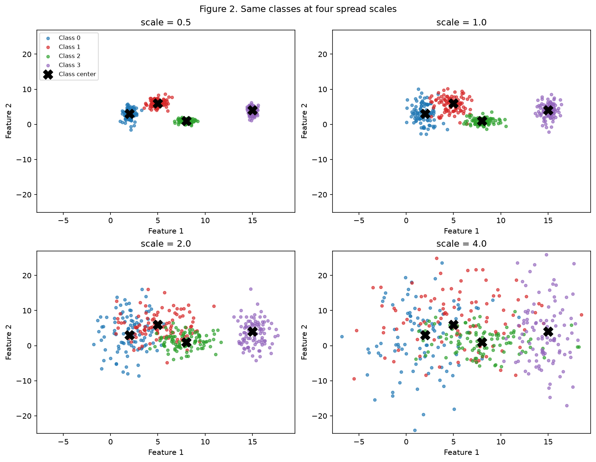
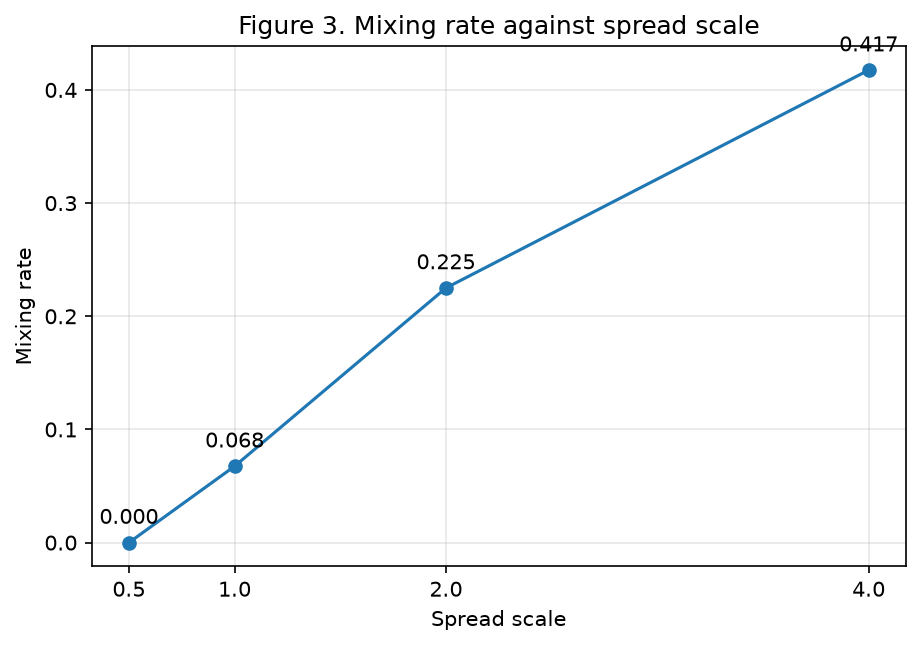
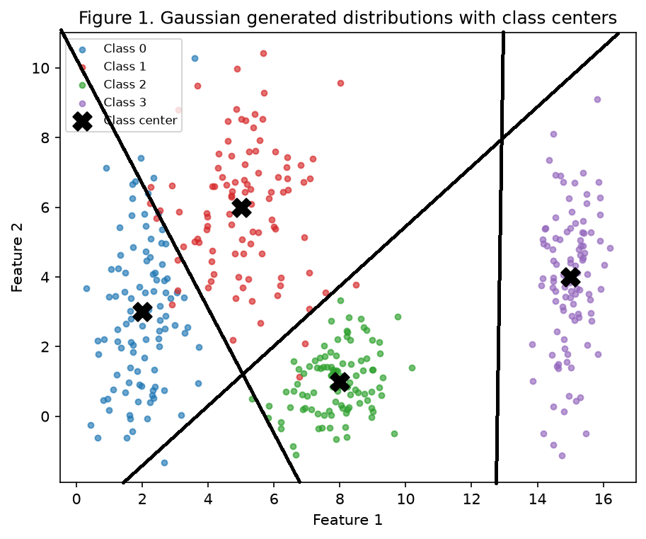
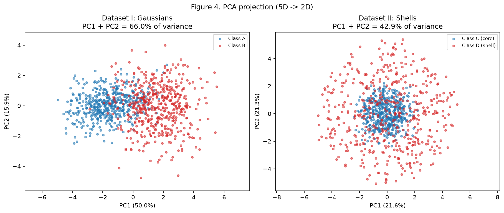
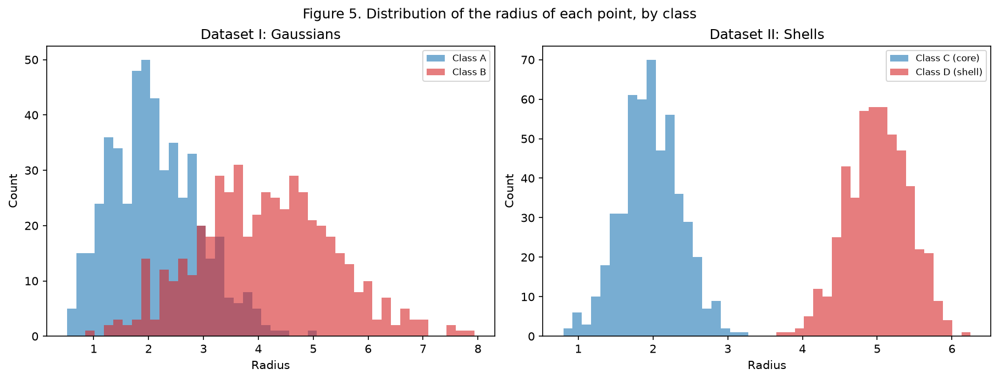
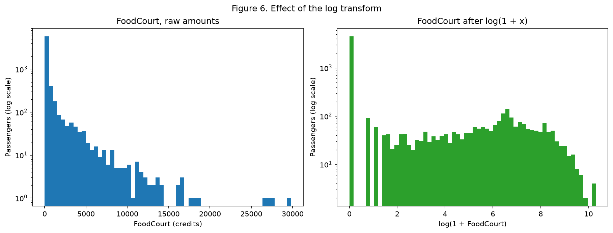

# Exercício 1: Data

> Entrega: 10/09/2026 (quinta), commits até 23:59.

## Abordagem e reprodutibilidade

Um script por exercício. Eles compartilham o [`base.py`](https://github.com/kikepuppi/neuralnetworks-and-deeplearning-insper/blob/main/docs/exercises/data/code/base.py) com a semente, os caminhos e um helper que salva figuras. Cada script roda sozinho a partir de um clone limpo:

```bash
python -m pip install -r requirements.txt
python docs/exercises/data/code/ex1_clouds.py
python docs/exercises/data/code/ex2_highdim.py
python docs/exercises/data/code/ex3_titanic.py
```

Todo script começa seu estado aleatório com `np.random.default_rng(42)` e usa esse único gerador até o fim, então os números saem idênticos em toda execução. O `scikit-learn` é usado só para o PCA e para o pré-processamento.

O arquivo `train.csv` do Kaggle está commitado em `docs/exercises/data/data/`.

## Exercício 1
Nuvens de pontos: geometria e espalhamento em 2D.

### A: Gerar as nuvens

400 amostras, 100 por classe. Cada classe é uma gaussiana com média própria e desvio padrão próprio.

| Classe | Média | Desvio padrão | Espalhamento médio `σ̄` |
|---|---|---|---|
| 0 | [2, 3] | [0.8, 2.5] | 1.65 |
| 1 | [5, 6] | [1.2, 1.9] | 1.55 |
| 2 | [8, 1] | [0.9, 0.9] | 0.90 |
| 3 | [15, 4] | [0.5, 2.0] | 1.25 |



### B: Mais ou menos espalhadas

Regerei as mesmas quatro classes quatro vezes, multiplicando todos os desvios padrão por `s ∈ {0.5, 1.0, 2.0, 4.0}`. As médias nunca se movem. São quatro datasets de quatro classes cada, não um dataset com quatro classes em escalas diferentes.



#### Razão de separação em `s = 1`

`r_ij = ‖μi - μj‖ / (σ̄i + σ̄j)`, com `σ̄k = (σ_kx + σ_ky) / 2`

| Par | `‖μi - μj‖` | `σ̄i + σ̄j` | `r_ij` |
|---|---|---|---|
| (0, 1) | 4.2426 | 3.20 | **1.3258** |
| (0, 2) | 6.3246 | 2.55 | 2.4802 |
| (0, 3) | 13.0384 | 2.90 | 4.4960 |
| (1, 2) | 5.8310 | 2.45 | 2.3800 |
| (1, 3) | 10.1980 | 2.80 | 3.6422 |
| (2, 3) | 7.6158 | 2.15 | 3.5422 |

A menor é o par **(0, 1), em 1.3258**, que são as duas nuvens que visivelmente se tocam na Figura 1.

As médias são fixas e só os espalhamentos escalam, então `r_ij(s) = r_ij(1) / s`. Em `s = 2` a menor razão vira **0.6629**, sem gerar nenhum ponto novo.

#### Taxa de mistura

A fração de pontos cujo centro de classe mais próximo não é o da própria classe. A distância de cada ponto até as quatro médias fixas.

| `s` | Menor `r_ij` | Taxa de mistura |
|---|---|---|
| 0.5 | 2.6516 | **0.0000** (0.00%) |
| 1.0 | 1.3258 | **0.0675** (6.75%) |
| 2.0 | 0.6629 | **0.2250** (22.50%) |
| 4.0 | 0.3315 | **0.4175** (41.75%) |



#### A partir de qual escala as retas deixam de separar as nuvens?

A partir de `s = 2`.

Em `s = 0.5` a taxa de mistura é exatamente zero, e em `s = 1` ela é 6.75%, quase toda na fronteira (0, 1). Em `s = 2` ela sobe para 22.50%, e aquele painel da Figura 2 mostra as classes 0, 1 e 2 como uma coisa só.

#### O que acontece com a menor `r_ij` nesse ponto?

Nesse mesmo ponto a menor `r_ij` cai abaixo de 1, para 0.6629. Abaixo de 1 significa que os dois centros estão mais perto um do outro do que a soma dos espalhamentos típicos deles, então as nuvens se sobrepõem em torno do próprio ponto médio e qualquer reta traçada entre os centros tem as duas classes dos dois lados.

### C: Análise

#### Descreva a sobreposição das quatro classes em `s = 1`

A classe 3 fica sozinha, nada mais chega perto de `x ≈ 15`. A classe 2 é compacta, embaixo e um pouco à direita, encosta na classe 1 só no topo. A sobreposição real é entre as classes 0 e 1, que é o par com o menor `r_ij`.

#### Uma única fronteira linear separaria todas as classes? E um conjunto de fronteiras lineares?

Não. Uma fronteira corta o plano em dois, então ela só expressa uma decisão de sim ou não. Quatro classes precisam de pelo menos três fronteiras.

#### Esboce na Figura 1 as fronteiras de decisão que você acha que uma rede treinada aprenderia



#### Quanto mais espalhadas as nuvens, o que acontece com a região onde a rede erra?

Ela fica maior. As fronteiras ficam quase iguais, mas as classes se sobrepõem mais. Nessa área de sobreposição a rede não consegue distinguir as classes. Mais treino ou mais dado não elimina esses erros. A taxa de erro cresce de 0% em `s = 0.5` para 41.75% em `s = 4`.

### Código

```python
--8<-- "docs/exercises/data/code/base.py"
```

```python
--8<-- "docs/exercises/data/code/ex1_clouds.py"
```

## Exercício 2
Não-linearidade em dimensões mais altas.

### A: Dataset I, gaussianas deslocadas

500 amostras para a classe A e 500 para a classe B, de normais multivariadas em 5 dimensões, com os vetores de média e as matrizes de covariância do enunciado.

### B: Dataset II, cascas concêntricas

500 amostras por classe, também em 5D. Sorteio `v ~ N(0, I₅)` e normalizo, `u = v / ‖v‖`, o que dá uma direção uniforme na esfera unitária. Cada ponto é `x = ρ · u`, com `ρ ~ N(2.0, 0.4)` para a classe C e `ρ ~ N(5.0, 0.4)` para a classe D.

Li o segundo argumento de `N(2.0, 0.4)` como o desvio padrão, que é o que `rng.normal(mean, std)` espera.

### C: Visualizar e comparar



#### Reporte a variância explicada dos dois primeiros componentes em cada caso

| Dataset | PC1 | PC2 | PC1 + PC2 |
|---|---|---|---|
| I: gaussianas deslocadas | 0.5004 | 0.1593 | **0.6597** (65.97%) |
| II: cascas concêntricas | 0.2159 | 0.2132 | **0.4291** (42.91%) |

#### Em qual dataset a projeção 2D preserva melhor a informação relevante para a classificação?

No Dataset I. Ali a direção de maior espalhamento é também a direção que separa as classes, então o PC1 sozinho segura metade da variância.

O Dataset II é isotrópico, então os cinco componentes têm mais ou menos o mesmo tamanho. A projeção guarda 42.91% da variância, e essa parte não carrega o rótulo.

#### A distância entre os centros das classes, em 5D

| Dataset | `‖μ1 - μ2‖` |
|---|---|
| I: gaussianas deslocadas | **3.2282** |
| II: cascas concêntricas | **0.2662** |

O Dataset II deveria dar exatamente zero, já que as duas classes são centradas na origem. Os 0.2662 são ruído amostral.

#### Figura 5: o histograma do raio de cada ponto



| Dataset | Classe | Média do raio | Desvio do raio |
|---|---|---|---|
| I | A | 2.1085 | 0.7869 |
| I | B | 4.1284 | 1.2248 |
| II | C (núcleo) | 1.9718 | 0.3956 |
| II | D (casca) | 5.0047 | 0.4094 |

No Dataset II as duas distribuições não se tocam. A classe C vai de mais ou menos 0.8 a 3.2, a classe D de 3.7 a 6.3.

### D: Análise

#### Os centros são próximos de zero, mas os histogramas de raio são bem separados. O que isso diz sobre separar as classes com um hiperplano?

Que não dá. Um hiperplano olha para uma direção de cada vez. As duas classes têm o mesmo centro, então em qualquer direção elas caem uma em cima da outra, com a mesma média. Onde quer que você corte, metade de cada classe fica de cada lado, uns 50%, o mesmo que chutar.

#### Explique por que a estrutura do Dataset II não se resolve com uma fronteira linear, por mais dados que se colete

A classe depende só da distância até a origem. Essa distância é a mesma se você girar o espaço, então a regra não liga para direção. Um hiperplano liga, ele aponta para algum lado, então não consegue copiar a regra. Mais dados não resolvem, o limite é o modelo.

#### Uma projeção 2D em que as classes parecem misturadas prova que elas são inseparáveis?

Não. O PCA guarda as direções de maior espalhamento, não as que separam as classes.

A minha própria figura mostra o caso contrário. O painel direito da Figura 4 não está misturado, é um núcleo azul dentro de um anel vermelho, e mesmo assim nenhuma reta separa as cores.

#### Uma função simples dos inputs que separa o Dataset II

`g(x) = Σᵢ xᵢ² - 12.25 = ‖x‖² - 3.5²`

O sinal de `g` dá a classe, negativo para o núcleo e positivo para a casca. 3.5 fica na metade entre o raio 2 e o raio 5. Só com essa feature os 1000 pontos saem certos, **100.00%**.

### Código

```python
--8<-- "docs/exercises/data/code/ex2_highdim.py"
```

## Exercício 3
Preparando dados do mundo real para uma rede neural.

### A: Conhecer os dados

#### O que a coluna `Transported` representa? Qual é o balanço de classes?

Se o passageiro foi levado para outra dimensão pela anomalia. É um booleano, então isto é classificação binária.

| `Transported` | Proporção |
|---|---|
| False | 49.64% |
| True | **50.36%** |

#### Liste as features, separando numéricas de categóricas

| Tipo | Colunas |
|---|---|
| Numéricas | `Age`, `RoomService`, `FoodCourt`, `ShoppingMall`, `Spa`, `VRDeck` |
| Categóricas | `HomePlanet`, `CryoSleep`, `Destination`, `VIP` |
| Identificador ou texto livre (descartadas) | `PassengerId`, `Cabin`, `Name` |

#### Tabela de valores ausentes por coluna

| Coluna | Ausentes | Percentual |
|---|---|---|
| CryoSleep | 217 | 2.50% |
| ShoppingMall | 208 | 2.39% |
| VIP | 203 | 2.34% |
| HomePlanet | 201 | 2.31% |
| Name | 200 | 2.30% |
| Cabin | 199 | 2.29% |
| VRDeck | 188 | 2.16% |
| FoodCourt | 183 | 2.11% |
| Spa | 183 | 2.11% |
| Destination | 182 | 2.09% |
| RoomService | 181 | 2.08% |
| Age | 179 | 2.06% |

#### Média, mediana e máximo das colunas de gasto

| Coluna | Média | Mediana | Máximo |
|---|---|---|---|
| RoomService | 224.69 | 0.00 | 14327.00 |
| FoodCourt | 458.08 | 0.00 | 29813.00 |
| ShoppingMall | 173.73 | 0.00 | 23492.00 |
| Spa | 311.14 | 0.00 | 22408.00 |
| VRDeck | 304.85 | 0.00 | 24133.00 |

#### Compare média e mediana: o que essa diferença diz sobre o espalhamento e a assimetria?

A mediana é zero nas cinco, mas as médias vão de 174 a 458. Ou seja, mais da metade dos passageiros não gastou nada, e a média vem de poucos que gastaram muito. As caudas são pesadas à direita. O `FoodCourt` chega a 29813, umas 65 vezes a própria média.

### B: Separar antes de transformar

80/20, estratificado por `Transported`, com semente fixa. Feito antes de qualquer estatística ser calculada.

| Split | Linhas | Proporção positiva |
|---|---|---|
| Treino | 6954 | 0.5036 |
| Teste | 1739 | 0.5037 |

#### Por que esse split vem antes da imputação e da escala

A mediana, o mínimo, o máximo e a lista de categorias são todos aprendidos dos dados. Se forem calculados no dataset inteiro, as linhas de teste vazam para dentro da transformação usada no treino. A nota de teste passa então a medir dado que o pipeline já viu, o que a faz parecer melhor do que é.

### C: Pré-processar

#### Dados ausentes: estratégia por tipo de coluna

Ajustada no treino e aplicada ao teste.

| Tipo | Estratégia | Valor aprendido no treino | Por quê |
|---|---|---|---|
| `Age` | mediana | 27.0 | A distribuição é assimétrica, e a mediana não é puxada pela cauda. |
| Colunas de gasto | mediana | 0.0 nas cinco | A mediana é 0, que é o que a maioria dos passageiros faz. A média inventaria gasto para gente sobre quem não sabemos nada. |
| Categóricas | mais frequente | Earth, False, TRAPPIST-1e, False | Mantém a coluna categórica sem um nível "ausente" aprendido a partir de 200 linhas. |

#### Converta as features categóricas para formato numérico

`HomePlanet`, `CryoSleep`, `Destination` e `VIP` viram 10 colunas binárias com one-hot:

`HomePlanet_Earth`, `HomePlanet_Europa`, `HomePlanet_Mars`, `CryoSleep_False`, `CryoSleep_True`, `Destination_55 Cancri e`, `Destination_PSO J318.5-22`, `Destination_TRAPPIST-1e`, `VIP_False`, `VIP_True`

One-hot em vez de código inteiro, porque código inteiro cria uma ordem que não existe.

#### Explique como o seu código trata uma categoria que aparece no teste mas não no treino

Com `OneHotEncoder(handle_unknown="ignore")`. O encoder é ajustado no treino, então as colunas dele ficam fixas ali. Uma categoria não vista vira zero em todas as colunas daquela feature, em vez de erro ou de uma coluna a mais.

#### Crie a feature `TotalSpend`

A soma das cinco colunas de gasto, calculada antes do log. `Cabin`, `Name` e `PassengerId` são descartadas.

#### Aplique `log(1 + x)` nas colunas de gasto

Aplicado nas cinco colunas de gasto e no `TotalSpend`. `log1p` e não `log` porque as colunas têm zeros de verdade.



#### Por que essa transformação ajuda uma rede com `tanh`?

O `FoodCourt` bruto vai de 0 a 29813, com metade dos valores exatamente em 0. Depois de uma reescala linear quase todo mundo fica em -1 e uns poucos outliers pegam o resto da faixa. A `tanh` é plana fora de mais ou menos `[-2, 2]`, então esses outliers quase não têm gradiente, e o resto da coluna quase não varia. Depois do log a coluna vai de 0 a 10.3 e os valores se espalham, então eles caem onde a `tanh` ainda tem gradiente.

#### Escala: implemente uma, explique a escolha e reporte o mínimo e o máximo

As sete colunas numéricas são normalizadas para `[-1, 1]` com o `MinMaxScaler`, ajustado no treino.

Escolhi normalização porque a `tanh` devolve `[-1, 1]`. Mapear a faixa de treino sobre isso coloca todo input onde a rede consegue aprender. A padronização deixa os extremos livres, e depois do log o `FoodCourt` ainda tem cauda.

| Conjunto | Mínimo | Máximo |
|---|---|---|
| Treino (colunas numéricas) | -1.0000 | 1.0000 |
| Teste (colunas numéricas) | -1.0000 | **1.1383** |

O teste passa de 1 porque alguém lá gastou 23492 em `ShoppingMall`, enquanto o máximo do treino era 12253. O scaler nunca viu o teste, então não tinha como saber. Se a faixa do teste fosse exatamente `[-1, 1]`, esse sim seria o resultado suspeito.

### D: Verificar e visualizar

A Figura 6 acima mostra o `FoodCourt` antes e depois do log, com o eixo de contagem em escala log.

#### Checagens finais

| Checagem | Treino | Teste |
|---|---|---|
| `NaN` restantes | **0** | **0** |
| Forma da matriz de features | **(6954, 17)** | **(1739, 17)** |
| Faixa de valores | [-1.0000, 1.0000] | [-1.0000, 1.1383] |

As 17 colunas são 7 numéricas mais 10 one-hot. A faixa serve para a `tanh`, que precisa de inputs dentro de mais ou menos `[-2, 2]`.

#### Qual das suas decisões de pré-processamento mais afetaria o treino da rede, e por quê?

O `log(1 + x)` nas colunas de gasto. As outras escolhas mudam pouco: uma imputação diferente afeta 2% das linhas, e min-max ou padronização mantêm os inputs numa faixa que a `tanh` aguenta. Sem o log, cinco das sete colunas numéricas ficariam quase constantes depois da escala, com metade dos passageiros no piso e uns poucos outliers sozinhos no topo. A rede receberia cinco inputs com quase nenhum gradiente, e teria que classificar só com `Age` e as colunas categóricas. As colunas de gasto são a parte mais preditiva deste dataset, então o log é o que as torna utilizáveis.

### Código

```python
--8<-- "docs/exercises/data/code/ex3_titanic.py"
```

## Resumo dos resultados

| # | Item | Valor |
|---|---|---|
| 1 | Taxa de mistura em `s = 0.5` | 0.0000 (0.00%) |
| 2 | Taxa de mistura em `s = 1.0` | 0.0675 (6.75%) |
| 3 | Taxa de mistura em `s = 2.0` | 0.2250 (22.50%) |
| 4 | Taxa de mistura em `s = 4.0` | 0.4175 (41.75%) |
| 5 | Menor `r_ij` em `s = 1.0`, e qual par | 1.3258, par (0, 1) |
| 6 | Distância entre centros, Dataset I | 3.2282 |
| 7 | Distância entre centros, Dataset II | 0.2662 |
| 8 | Variância explicada PC1 + PC2, Dataset I | 0.6597 (65.97%) |
| 9 | Variância explicada PC1 + PC2, Dataset II | 0.4291 (42.91%) |
| 10 | Proporção da classe positiva em `Transported` | 0.5036 (50.36%) |
| 11 | Média e mediana de `FoodCourt` no treino, antes de transformar | média 452.6112, mediana 0.0000 |
| 12 | Forma final da matriz de features de treino | (6954, 17) |
| 13 | Mínimo e máximo após a escala | treino [-1.0000, 1.0000], teste [-1.0000, 1.1383] |
