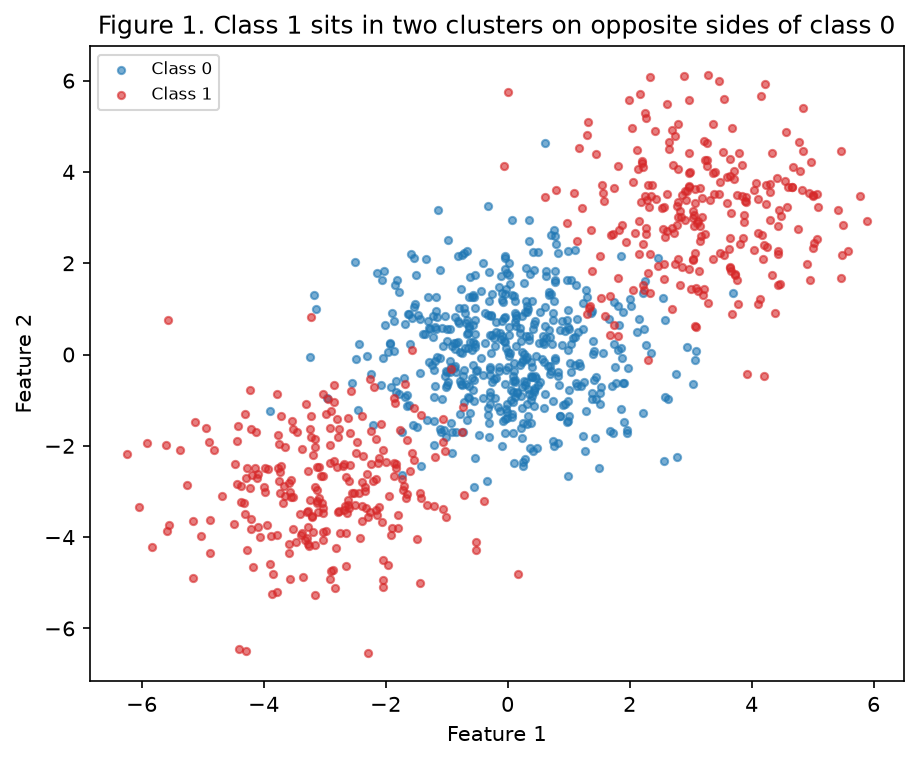
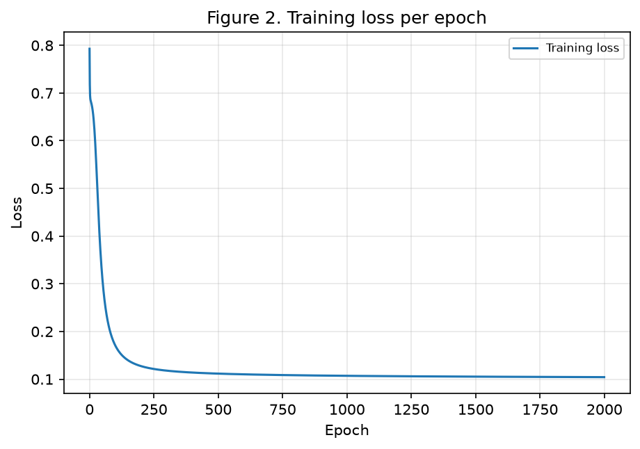
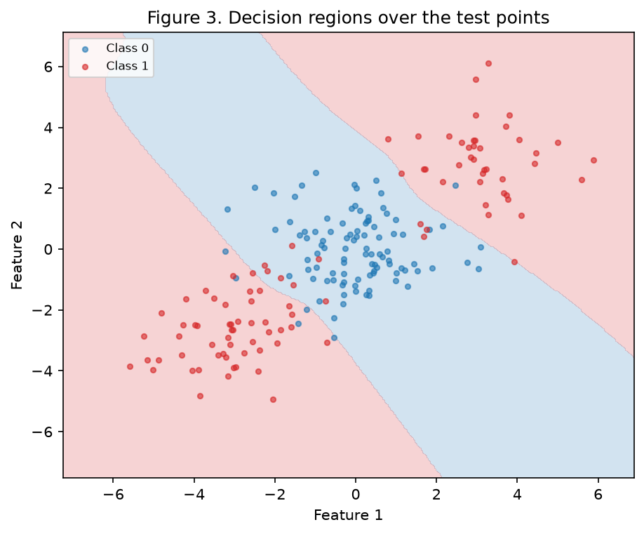
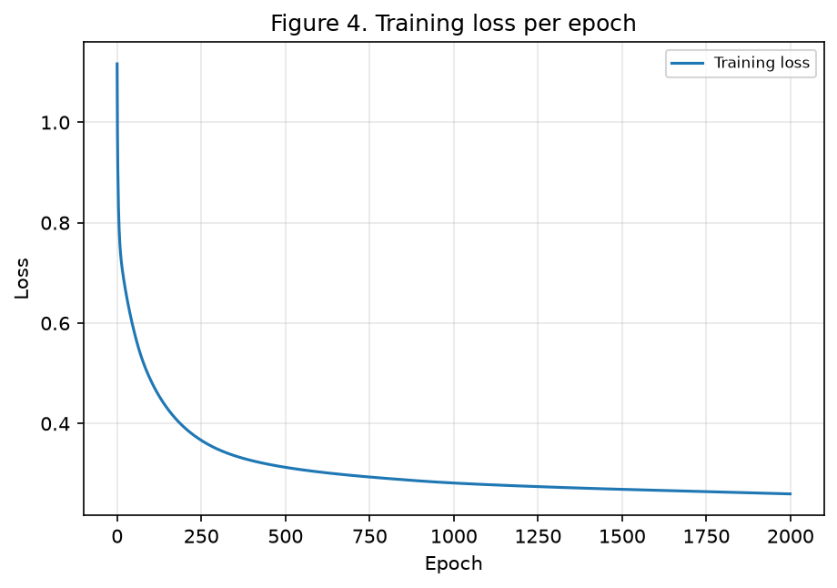
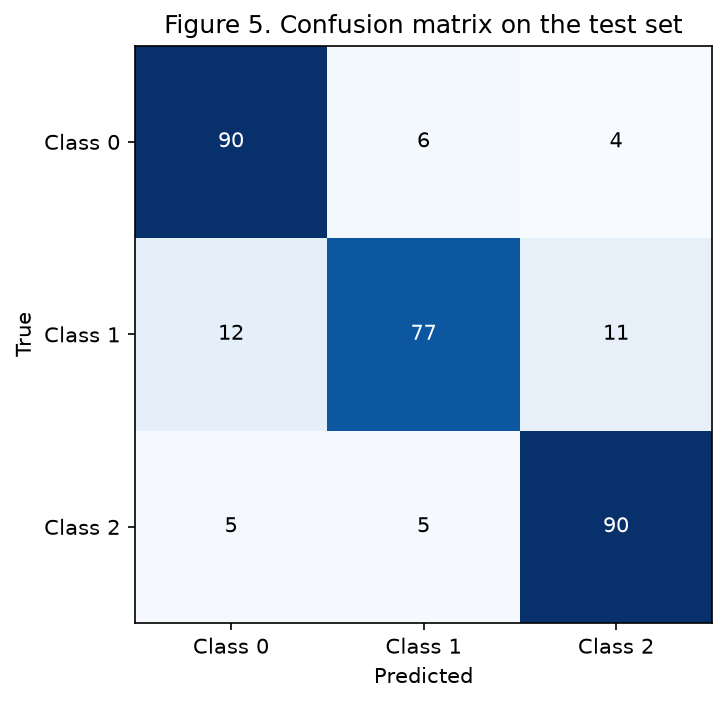
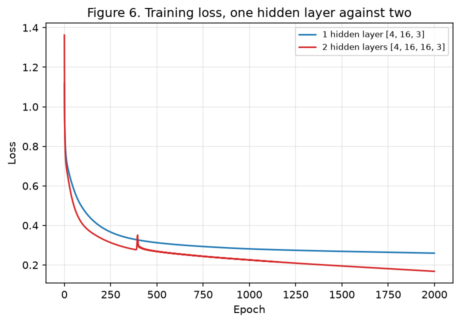

# Exercise 3: MLP

> Due: Oct 25, 2026 (Sunday), commits until 23:59.

## Approach and reproducibility

Exercise 1 is done by hand, in this page. There is no script for it.

Exercises 2, 3 and 4 share [`base.py`](https://github.com/kikepuppi/neuralnetworks-and-deeplearning-insper/blob/main/docs/exercises/mlp/code/base.py) with the seed, the paths and the figures, and [`mlp.py`](https://github.com/kikepuppi/neuralnetworks-and-deeplearning-insper/blob/main/docs/exercises/mlp/code/mlp.py) with the network. Each script runs on its own from a clean clone:

```bash
python -m pip install -r requirements.txt
python docs/exercises/mlp/code/ex2_blobs.py
python docs/exercises/mlp/code/ex3_multiclass.py
python docs/exercises/mlp/code/ex4_depth.py
```

Each script starts its random state with `np.random.default_rng(42)`, so the numbers come out identical on every run. Exercise 4 is the one exception, because item B asks for three seeds.

`mlp.py` is used by the three exercises without changes. The forward pass, the backward pass and the update are the same code. What changes between them is the argument list: the layer sizes, the output activation and the loss. `scikit-learn` appears only for generating the data, splitting it, the confusion matrix and the linear baseline.

The part that took real work was getting one backward pass to serve two different losses. It only works because both end at `p - y`, which is derived in item 3B.

## Exercise 1
One step of backpropagation, by hand.

With `x = [0.5, -0.2]`, `y = 1.0`, `W¹ = [[0.3, -0.1], [0.2, 0.4]]`, `b¹ = [0.1, -0.2]`, `W² = [0.5, -0.3]`, `b² = 0.2` and `η = 0.3`.

### A: Forward pass

`z¹ = W¹ x + b¹`

```
z¹₁ = (0.3)(0.5) + (-0.1)(-0.2) + 0.1 = 0.15 + 0.02 + 0.10 = 0.2700
z¹₂ = (0.2)(0.5) + ( 0.4)(-0.2) - 0.2 = 0.10 - 0.08 - 0.20 = -0.1800
```

`h¹ = tanh(z¹)`

```
h¹₁ = tanh( 0.2700) =  0.2636
h¹₂ = tanh(-0.1800) = -0.1781
```

`u² = W² h¹ + b²`

```
u² = (0.5)(0.2636) + (-0.3)(-0.1781) + 0.2 = 0.1318 + 0.0534 + 0.2000 = 0.3852
```

`ŷ = tanh(u²)` and `L = (y - ŷ)²`

```
ŷ = tanh(0.3852) = 0.3672
L = (1.0 - 0.3672)² = (0.6328)² = 0.4004
```

### B: Backward pass

Starting from the loss and chaining outward.

`∂L/∂ŷ = -2(y - ŷ)`

```
∂L/∂ŷ = -2(1.0 - 0.3672) = -1.2655
```

`∂L/∂u² = (∂L/∂ŷ)(1 - ŷ²)`, using `d tanh(u)/du = 1 - tanh²(u)`

```
1 - ŷ² = 1 - (0.3672)² = 1 - 0.1348 = 0.8652
∂L/∂u² = (-1.2655)(0.8652) = -1.0948
```

Output layer. Since `u² = W² h¹ + b²`, then `∂u²/∂W² = h¹` and `∂u²/∂b² = 1`:

```
∂L/∂W² = (∂L/∂u²) h¹ = (-1.0948)[0.2636, -0.1781] = [-0.2886, 0.1950]
∂L/∂b² = ∂L/∂u² = -1.0948
```

Propagate back. Since `∂u²/∂h¹ = W²`:

```
∂L/∂h¹ = (∂L/∂u²) W² = (-1.0948)[0.5, -0.3] = [-0.5474, 0.3285]
```

`∂L/∂z¹ = (∂L/∂h¹)(1 - (h¹)²)`, elementwise:

```
1 - (h¹₁)² = 1 - 0.0695 = 0.9305    ∂L/∂z¹₁ = (-0.5474)(0.9305) = -0.5094
1 - (h¹₂)² = 1 - 0.0317 = 0.9683    ∂L/∂z¹₂ = ( 0.3285)(0.9683) =  0.3180
```

Hidden layer. Since `z¹ = W¹ x + b¹`, each row of `∂L/∂W¹` is `∂L/∂z¹ᵢ` times `x`:

```
∂L/∂W¹ = [[(-0.5094)(0.5), (-0.5094)(-0.2)],     [[-0.2547,  0.1019],
          [( 0.3180)(0.5), ( 0.3180)(-0.2)]]  =   [ 0.1590, -0.0636]]

∂L/∂b¹ = ∂L/∂z¹ = [-0.5094, 0.3180]
```

### C: Parameter update

Every parameter moves by `-η` times its gradient, with `η = 0.3`.

```
W¹₁₁ = 0.3 - (0.3)(-0.2547) =  0.3764      W¹₁₂ = -0.1 - (0.3)( 0.1019) = -0.1306
W¹₂₁ = 0.2 - (0.3)( 0.1590) =  0.1523      W¹₂₂ =  0.4 - (0.3)(-0.0636) =  0.4191

b¹₁  = 0.1 - (0.3)(-0.5094) =  0.2528      b¹₂  = -0.2 - (0.3)( 0.3180) = -0.2954

W²₁  = 0.5 - (0.3)(-0.2886) =  0.5866      W²₂  = -0.3 - (0.3)( 0.1950) = -0.3585

b²   = 0.2 - (0.3)(-1.0948) =  0.5284
```

#### State whether the loss would go up or down on a second forward pass, and why

Down. Gradient descent moves every parameter against its gradient, so for a small enough `η` the loss has to fall.

The second forward pass confirms it:

```
z¹ = [ (0.3764)(0.5) + (-0.1306)(-0.2) + 0.2528,
       (0.1523)(0.5) + ( 0.4191)(-0.2) - 0.2954 ] = [0.4671, -0.3030]

h¹ = [0.4359, -0.2941]

u² = (0.5866)(0.4359) + (-0.3585)(-0.2941) + 0.5284 = 0.8895

ŷ  = tanh(0.8895) = 0.7112

L  = (1.0 - 0.7112)² = 0.0834
```

The loss drops from **0.4004** to **0.0834**, and `ŷ` moves from 0.3672 toward the target of 1.0.

## Exercise 2
Binary classification a straight line cannot do.

### A: Generate the data

`make_blobs` with the three centers from the statement, 500 points in the middle cluster and 250 in each of the outer two. Class 1 is the two outer clusters. Split 80/20, stratified, seed 42.

| Split | Samples | Class 1 share |
|---|---|---|
| Train | 800 | 0.5000 |
| Test | 200 | 0.5000 |



### B: Establish the baseline

Logistic regression on the training set reaches **0.4750** on the test set, worse than guessing.

### C: Implement the MLP

One hidden layer of 8 units with `tanh`, one output unit with sigmoid, binary cross-entropy, plain gradient descent on the full batch.

| Setting | Value |
|---|---|
| Architecture | **[2, 8, 1]** |
| Parameters | 33 |
| Learning rate | 0.5 |
| Epochs | 2000 |
| Training loss | 0.7930 to **0.1043** |
| Test accuracy | **0.9150** |





### D: Analysis

#### Why does the linear baseline score below 50% while your MLP clears 90%?

Because the two class 1 clusters sit on opposite sides of class 0, so they pull the logistic regression weights in opposite directions and the two pulls cancel. The fitted vector collapses to almost nothing, `‖w‖ = 0.0297` with intercept -0.0031, which is a nearly flat model that answers close to a coin flip. On the test set it predicted class 0 for 111 points and class 1 for 89.

A nearly flat model lands near 50% without aiming at it, and 0.4750 is the side it happened to fall on.

#### Describe the shape of the region your network assigns to Class 1, and explain why no single straight line can produce it

In Figure 3 class 1 gets two separate regions, the top right corner and the bottom left corner, with the class 0 band running diagonally between them. The class 1 region is disconnected.

A straight line cuts the plane into two half planes, and a half plane is a single connected piece. So one line can never hand class 1 two separate corners while keeping class 0 in the middle. The network draws the band because each hidden unit contributes its own line and the output layer combines them, so it can keep class 0 between two of them.

### Code

```python
--8<-- "docs/exercises/mlp/code/base.py"
```

```python
--8<-- "docs/exercises/mlp/code/mlp.py"
```

```python
--8<-- "docs/exercises/mlp/code/ex2_blobs.py"
```

## Exercise 3
Multi-class, same network.

### A: Generate the data

`make_classification` with 1500 samples, 4 informative features, 3 classes and 2 clusters per class. Split 80/20, stratified, seed 42.

That gives 1200 training and 300 test samples, with class shares on train of 0.3325, 0.3325 and 0.3350.

### B: Adapt the network

The output layer goes to 3 units, softmax turns them into probabilities, and categorical cross-entropy replaces the binary one. Nothing else changes.

#### Derive `∂L/∂u` for the softmax and cross-entropy pair

For one sample, with `p = softmax(u)` and `y` one-hot:

```
p_k = e^(u_k) / Σ_j e^(u_j)        L = -Σ_k y_k log p_k
```

The softmax derivative is

```
∂p_k/∂u_i = p_k (δ_ki - p_i)
```

Chaining it into the loss:

```
∂L/∂u_i = -Σ_k (y_k / p_k)(∂p_k/∂u_i)
        = -Σ_k (y_k / p_k) p_k (δ_ki - p_i)
        = -Σ_k y_k (δ_ki - p_i)
        = -(y_i - p_i Σ_k y_k)
```

`y` is one-hot, so `Σ_k y_k = 1` and the whole thing collapses to

```
∂L/∂u_i = p_i - y_i
```

The `p_k` from the softmax derivative cancels the `1/p_k` from the log derivative, which is what makes the result this simple. Sigmoid with binary cross-entropy gives `∂L/∂u = p - y` too, so over the batch both become `(p - y)/N`. That is the first line of `backward` in `mlp.py`, and it is why the same code serves Exercises 2 and 3.

### C: Train and evaluate

| Setting | Value |
|---|---|
| Architecture | **[4, 16, 3]** |
| Parameters | 131 |
| Learning rate | 0.5 |
| Epochs | 2000 |
| Training loss | 1.1166 to **0.2597** |
| Test accuracy | **0.8567** |





### D: Analysis

#### Which pair of classes does the network confuse most, according to Figure 5?

Classes 0 and 1, with **18** errors counting both directions.

| Pair | Errors both ways |
|---|---|
| 0 and 1 | **18** |
| 1 and 2 | 16 |
| 0 and 2 | 9 |

Class 1 is the weak one on its own too: 77 of its 100 test points are right, against 90 for each of the other two.

#### The data has 4 informative dimensions and 6 clusters total. Offer an explanation for the confusion that refers to that structure

Each class is two clusters, so the 3 classes are 6 blobs scattered in 4 dimensions with `class_sep=1.0`, which keeps them close together. A class covers two regions that may sit nowhere near each other.

That makes neighbours matter more than classes. If one of the class 1 blobs happens to land next to a class 0 blob, every point in the overlap is lost, and the network cannot fix it by moving the class 1 boundary without giving up its other blob. Class 1 loses points to 0 and to 2 in similar amounts, 12 and 11.

#### Report the logistic regression baseline on this data and say what the hidden layer added

The baseline gets **0.6633**, against **0.8567** for the network, so the hidden layer added **19.3 points**.

Logistic regression draws one boundary per class and so assigns each class a single connected region. With two clusters per class that is impossible to do well. The hidden layer builds intermediate features first, which lets the output layer group two separate blobs under the same label.

### Code

```python
--8<-- "docs/exercises/mlp/code/ex3_multiclass.py"
```

## Exercise 4
Does a second hidden layer help?

### A: Train the deeper network

Same data, same seed, same learning rate and same number of epochs as Exercise 3. The only change is one extra hidden layer.

| Setting | Value |
|---|---|
| Architecture | **[4, 16, 16, 3]** |
| Parameters | 403 |
| Learning rate | 0.5 |
| Epochs | 2000 |
| Training loss | **0.1680** |
| Test accuracy | **0.8533** |

### B: Compare



Both models trained with seeds 42, 43 and 44, with everything else fixed.

| | Hidden layers | Parameters | Final train loss | Test accuracy |
|---|---|---|---|---|
| Exercise 3 | 1 | 131 | 0.2617 | 0.8489 |
| Exercise 4 | 2 | 403 | **0.1723** | **0.8522** |

Both columns are the mean over the three seeds. Per seed the accuracies were 0.8567, 0.8367 and 0.8533 for one layer, and 0.8533, 0.8467 and 0.8567 for two.

### C: Analysis

#### Explain the result

The deeper network wins on training loss and ties on test accuracy. It cuts the loss by **0.0894**, a 34% drop, and gains **0.0033** of accuracy, which is 1 point out of 300.

That gain is smaller than the spread between seeds. One layer ranged over 0.0200 across the three seeds, which is six times the difference between the two models. So the comparison says the two models are the same, and running a single seed could have shown either one winning.

The three times larger parameter count went into fitting the training set, not into generalizing. In Figure 6 the two loss curves separate clearly while the accuracy does not move.

The data explains why. 6 Gaussian blobs in 4 dimensions need a boundary that is curved and piecewise, but not deep. One hidden layer of 16 units already supplies that, and a second layer adds depth the problem has no use for, while making the optimization harder.

#### Say what kind of data would make the extra depth pay off

Data where the useful features are themselves built from other features, in stages. Images are the standard case: edges, then corners, then parts, then objects. Each layer reuses what the one below it found, so depth multiplies what you can express instead of just widening it.

The common shape is raw, high dimensional input with compositional structure, like pixels, audio samples or text. Here the input is 4 ready made informative features with no hierarchy underneath them, so there is nothing for a second layer to compose.

### Code

```python
--8<-- "docs/exercises/mlp/code/ex4_depth.py"
```

## Results summary

| # | Quantity | Value |
|---|---|---|
| 1 | Ex. 1, `z¹` and `h¹` | z¹ = [0.2700, -0.1800], h¹ = [0.2636, -0.1781] |
| 2 | Ex. 1, `u²`, `ŷ` and `L` | u² = 0.3852, ŷ = 0.3672, L = 0.4004 |
| 3 | Ex. 1, the eight updated parameters | W¹ = [[0.3764, -0.1306], [0.1523, 0.4191]], b¹ = [0.2528, -0.2954], W² = [0.5866, -0.3585], b² = 0.5284 |
| 4 | Ex. 2, linear baseline test accuracy | 0.4750 |
| 5 | Ex. 2, architecture and test accuracy | [2, 8, 1], 0.9150 |
| 6 | Ex. 3, architecture and test accuracy | [4, 16, 3], 0.8567 |
| 7 | Ex. 3, most-confused class pair | classes 0 and 1, 18 errors |
| 8 | Ex. 4, architecture and test accuracy | [4, 16, 16, 3], 0.8533 |
| 9 | Ex. 4, accuracy difference against Ex. 3 (mean over 3 seeds) | +0.0033 (0.8522 against 0.8489) |
