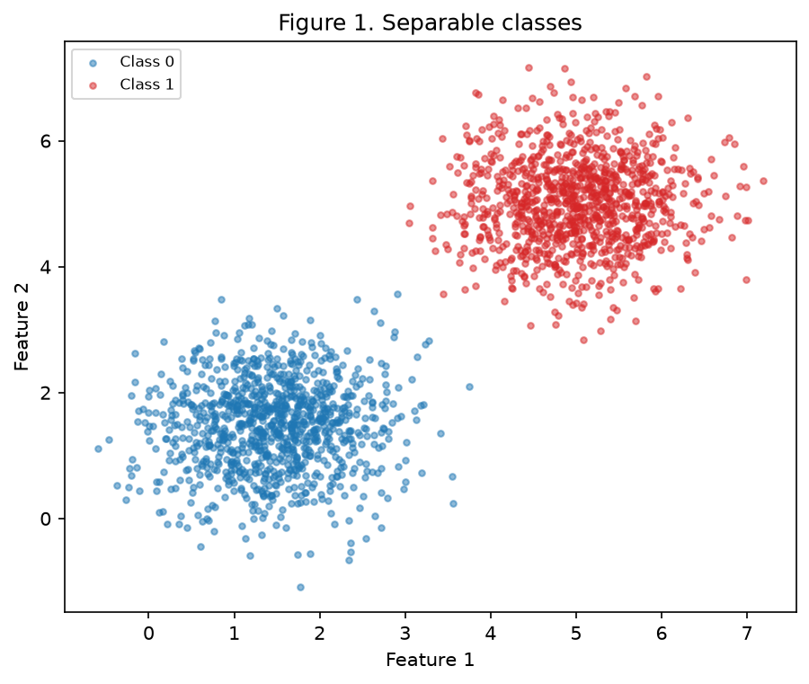
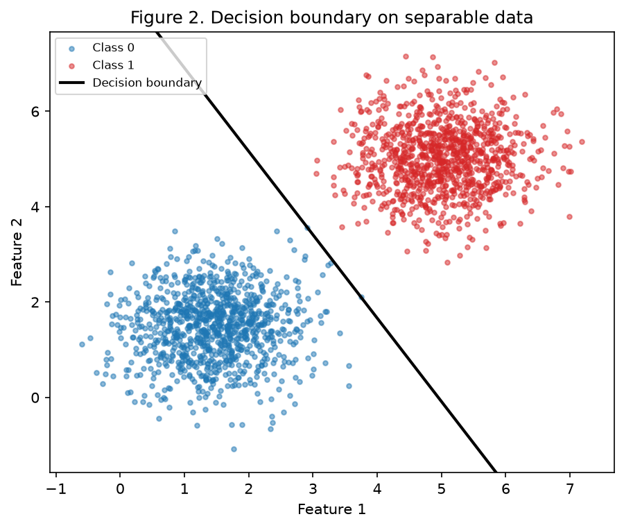
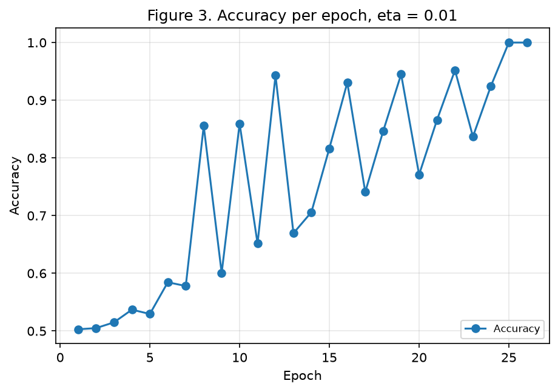
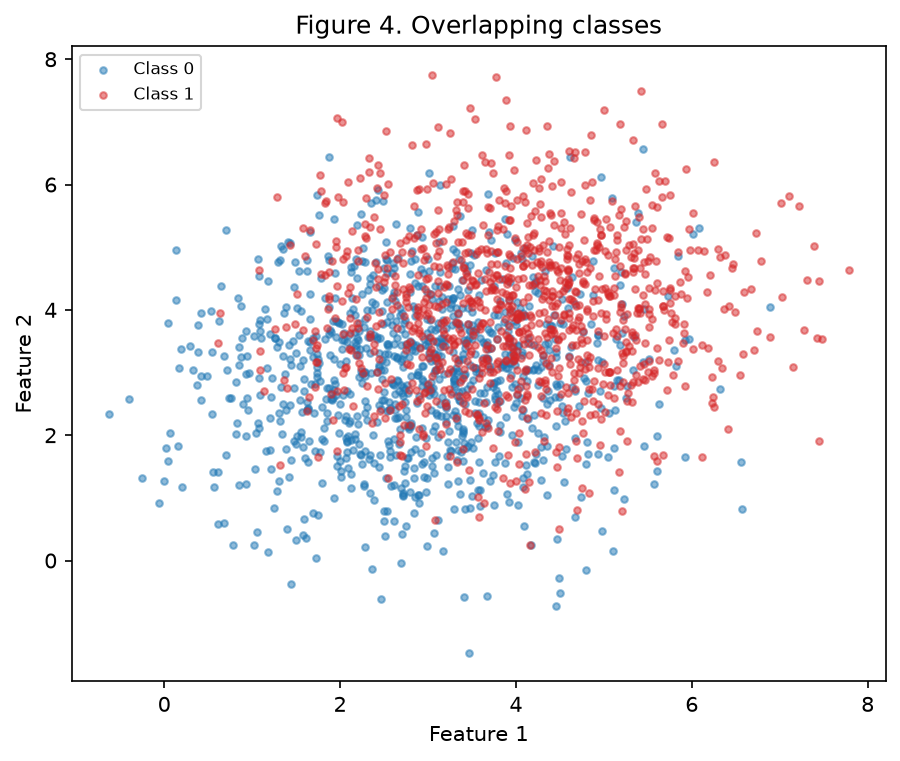
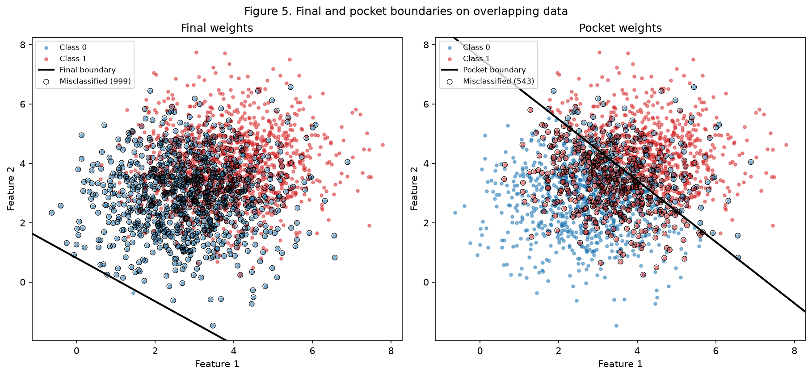
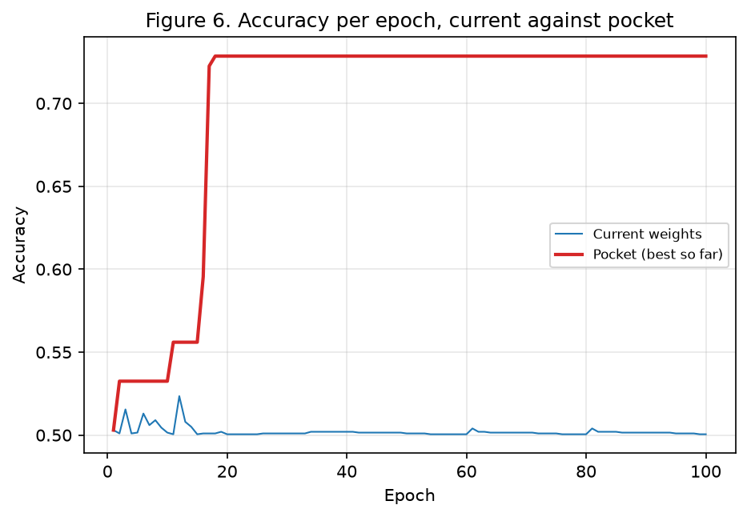

# Exercise 2: Perceptron

> Due: Sep 29, 2026 (Tuesday), commits until 23:59.

## Approach and reproducibility

One script per exercise. They share [`base.py`](https://github.com/kikepuppi/neuralnetworks-and-deeplearning-insper/blob/main/docs/exercises/perceptron/code/base.py) with the seed, the paths, the data generation and the plotting, and [`perceptron.py`](https://github.com/kikepuppi/neuralnetworks-and-deeplearning-insper/blob/main/docs/exercises/perceptron/code/perceptron.py) with the model. Each script runs on its own from a clean clone:

```bash
python -m pip install -r requirements.txt
python docs/exercises/perceptron/code/ex1_separable.py
python docs/exercises/perceptron/code/ex2_overlap.py
```

Each script starts its random state with `np.random.default_rng(42)` and uses that one generator until the end, so the numbers come out identical on every run. The perceptron is written from scratch with numpy. No library supplies the model.

The same `Perceptron` class is used in both exercises, with the pocket already inside it. Exercise 1 does not need the pocket, so it simply ignores it, and Exercise 2 reuses the class without a single change.

What took the longest was not the training loop but reading the results. In Exercise 2 a 50% accuracy looks like a bug, and the way to tell that it is not is to check where the boundary ended up instead of looking at the number alone.

## Exercise 1
Separable data: the case the perceptron was designed for.

### A: Generate the data

2000 samples, 1000 per class, drawn from 2D multivariate normals.

| Class | Mean | Covariance |
|---|---|---|
| 0 | [1.5, 1.5] | [[0.5, 0], [0, 0.5]] |
| 1 | [5, 5] | [[0.5, 0], [0, 0.5]] |



### B: Implement the perceptron

Prediction is `ŷ = step(w · x + b)`, with `step(z) = 1` when `z >= 0` and `0` otherwise.

The update runs sample by sample: `w ← w + η (y - ŷ) x` and `b ← b + η (y - ŷ)`. With labels in `{0, 1}` the error `y - ŷ` is `0` on a hit, so only mistakes move the weights.

Weights start at `w = [0.002532, 0.008952]`, drawn from `rng.normal(0, 0.01, size=2)`, and `b = 0`. The learning rate is `η = 0.01`. Training stops on the first full pass with no update, or at 100 epochs.

### C: Train and measure

| Quantity | Value |
|---|---|
| Final `w` | **[0.0505, 0.0289]** |
| Final `b` | **-0.2500** |
| Epochs | **26** |
| Final accuracy | **1.0000** (100%) |
| Misclassified points | 0 |

The 26th epoch is the one that made no update and stopped the loop. The last weight change happened in epoch 25.



Figure 2 has no misclassified markers because there are none.



### D: Analysis

#### Why does separable data converge quickly? Connect your answer to the update rule: what happens to the number of updates per epoch as training progresses?

Because a correct prediction gives `y - ŷ = 0` and produces no update. Only mistakes move the weights, so the loop is driven by its own errors and stops itself once there are none.

The number of updates per epoch is small from the start and then dies out:

| Epoch | 1 | 5 | 10 | 15 | 20 | 23 | 24 | 25 | 26 |
|---|---|---|---|---|---|---|---|---|---|
| Updates | 3 | 3 | 4 | 3 | 2 | 2 | 3 | 1 | **0** |

It is not a smooth decline. It sits between 2 and 4 for most of the run, drops to 1 in epoch 25 and to 0 in epoch 26. The clouds are far apart, so only a handful of points near the boundary are ever wrong, and each pass nudges the line a little further until none of them are.

#### Re-run the training with `η = 1.0`, changing nothing else. Report the epoch count and the final accuracy, and compare the direction of `w` against the `η = 0.01` run

Both runs start from the same `w` and `b`. Only `η` changes.

| Run | `w` | `b` | Epochs | Accuracy | Direction `w / ‖w‖` |
|---|---|---|---|---|---|
| `η = 0.01` | [0.0505, 0.0289] | -0.2500 | **26** | **1.0000** | [0.8681, 0.4963] |
| `η = 1.00` | [5.8706, 3.3592] | -31.0000 | **37** | **1.0000** | [0.8679, 0.4967] |

The two directions are **0.02 degrees** apart, so they are the same direction for any practical purpose. The boundaries are still different lines, because the offset differs: `b / ‖w‖` is -4.2979 against -4.5832. And the epoch counts differ, 26 against 37.

#### What does `η` control, given that every update adds `η x` to weights that started at a magnitude of about 0.01?

It controls the size of a step relative to the starting weights, which are the only thing `η` does not scale.

The mean `‖x‖` here is 4.6543, so one update adds about `0.01 × 4.65 = 0.047` at `η = 0.01` and about `4.65` at `η = 1.0`. The initial `w` has magnitude 0.009303. So the random start is about 20% of one step in the slow run and 0.2% of one step in the fast run.

That is why the two runs take different numbers of epochs while ending up pointing the same way. The data decides the direction. `η` decides how much the random start still matters along the way.

#### Show algebraically that training twice, from `w = 0` and `b = 0`, with `η₁` and `η₂`, produces weights that differ only by the factor `η₂ / η₁`

From a zero start, after any sequence of mistakes `(x₁, e₁), …, (x_t, e_t)`:

`w = η Σ eᵢ xᵢ` and `b = η Σ eᵢ`

Take two runs with `η₁` and `η₂`, and suppose they have made the same mistakes so far. Then `w₂ = (η₂/η₁) w₁` and `b₂ = (η₂/η₁) b₁`, and the factor `η₂/η₁` is positive.

The next prediction is `step(w · x + b)`, which only looks at whether `w · x + b >= 0`. Multiplying by a positive constant does not change that, not even at the tie `z = 0`. So both runs predict the same thing, make the same mistake, and the relation still holds after the update. By induction it holds to the last epoch.

Same mistakes means the same epoch count, and `w · x + b = 0` and `(η₂/η₁)(w · x + b) = 0` are the same line. So `η` would change nothing, which is why item B asks for a non-zero start.

Running it confirms the algebra:

| Run from `w = 0` | `w` | `b` | Epochs |
|---|---|---|---|
| `η = 0.01` | [0.058681, 0.033503] | -0.310000 | 37 |
| `η = 1.00` | [5.868084, 3.350287] | -31.000000 | 37 |
| Ratio | [100.0, 100.0] | 100.0 | equal |

### Code

```python
--8<-- "docs/exercises/perceptron/code/base.py"
```

```python
--8<-- "docs/exercises/perceptron/code/perceptron.py"
```

```python
--8<-- "docs/exercises/perceptron/code/ex1_separable.py"
```

## Exercise 2
Overlapping data: the case the perceptron cannot solve.

### A: Generate the data

Same 1000 samples per class, means much closer and spread three times larger.

| Class | Mean | Covariance |
|---|---|---|
| 0 | [3, 3] | [[1.5, 0], [0, 1.5]] |
| 1 | [4, 4] | [[1.5, 0], [0, 1.5]] |



### B: Train, keeping the best weights

The same class from Exercise 1, same `η = 0.01`, same 100-epoch cap, same initialization. The pocket keeps a copy of `(w, b)` every time an update produces a higher accuracy on the full dataset than any seen before.

| Weights | `w` | `b` | Accuracy |
|---|---|---|---|
| Final | [0.0361, 0.0494] | -0.0400 | **0.5005** |
| Pocket | [0.0068, 0.0066] | -0.0500 | **0.7285** |

The pocket best was found at **epoch 18**, and training ran the full 100 epochs without ever stopping.

### C: Figures



The final weights get 999 of the 2000 points wrong, the pocket weights 543.



### D: Analysis

#### Explain the gap between the pocket and the final accuracy. Where does the final boundary sit relative to the data cloud, and why does the training loop leave it there?

The final boundary sits outside the cloud, in the bottom left of Figure 5. Almost everything is on one side of it, so the model answers 1 for almost every point: all 1000 of class 1 right, and 999 of the 1000 of class 0 wrong. That is the 0.5005.

The reason is in the sizes of the two steps. A mistake moves `b` by `η = 0.0100`, but it moves `w` by `η ‖x‖ = 0.0507`, about five times more. To cut through a cloud centered on `[3.5, 3.5]`, `b` has to cancel `w · [3.5, 3.5]`, and it cannot keep up with a `w` that grows five times faster.

The numbers say the same thing:

| Weights | `w · [3.5, 3.5] + b` |
|---|---|
| Final | **0.2592** |
| Pocket | **-0.0029** |

The pocket value is essentially zero, so that boundary passes through the middle of the data. The final value is clearly positive, so the centre of the cloud is on the positive side and so is nearly everything around it.

The loop leaves it there because it has no reason not to. It is not minimizing anything. It reacts to whichever point it saw last, and the samples are stored class 0 first and class 1 second, so the last thing every epoch does is take a run of class 1 mistakes and push the boundary away.

#### Compare Figure 3 with Figure 6. What does the perceptron convergence theorem guarantee, and which of its assumptions does this dataset violate?

In Figure 3 the curve rises and settles at 1.0, and the loop stops on its own at epoch 26. In Figure 6 the blue curve never settles. It stays between 0.5005 and 0.5235 for all 100 epochs and only stops because the cap says so.

The convergence theorem guarantees that the perceptron makes a finite number of mistakes and terminates, bounded by `(R/γ)²`, where `R` is the largest `‖x‖` and `γ` is the margin. It assumes the data is linearly separable with a positive margin `γ`.

This dataset has no such margin. The clouds overlap, so no line has all the points on the correct side, `γ` does not exist and the bound is meaningless.

#### Does adding more epochs fix it? Does a smaller `η`?

Neither.

More epochs do not help because there is no state where the loop stops. Some point is always misclassified, so every epoch produces updates and the weights keep moving. Figure 6 shows the current accuracy flat at about 50% from epoch 20 to epoch 100, and the pocket has not improved since epoch 18.

A smaller `η` does not help because it scales `w` and `b` together. The ratio between the two steps stays `1 : ‖x‖` whatever `η` is, so the offset falls behind exactly as much. That is the same argument as the zero start in Exercise 1: shrinking every step by the same factor moves the weights to a smaller scale, not to a better line.

What does help is the pocket, and it is not a change to the update rule. It just stops throwing away the good weights the loop passes through.

### Code

```python
--8<-- "docs/exercises/perceptron/code/ex2_overlap.py"
```

## Results summary

| # | Quantity | Value |
|---|---|---|
| 1 | Exercise 1, final `w` and `b` | w = [0.0505, 0.0289], b = -0.2500 |
| 2 | Exercise 1, epochs to convergence | 26 |
| 3 | Exercise 1, final accuracy | 1.0000 (100%) |
| 4 | Exercise 1, epochs and final accuracy with `η = 1.0` | 37 epochs, 1.0000 (100%) |
| 5 | Exercise 2, final `w` and `b` | w = [0.0361, 0.0494], b = -0.0400 |
| 6 | Exercise 2, accuracy of the final weights | 0.5005 (50.05%) |
| 7 | Exercise 2, accuracy of the pocket weights | 0.7285 (72.85%) |
| 8 | Exercise 2, epoch at which the pocket best occurred | 18 |
